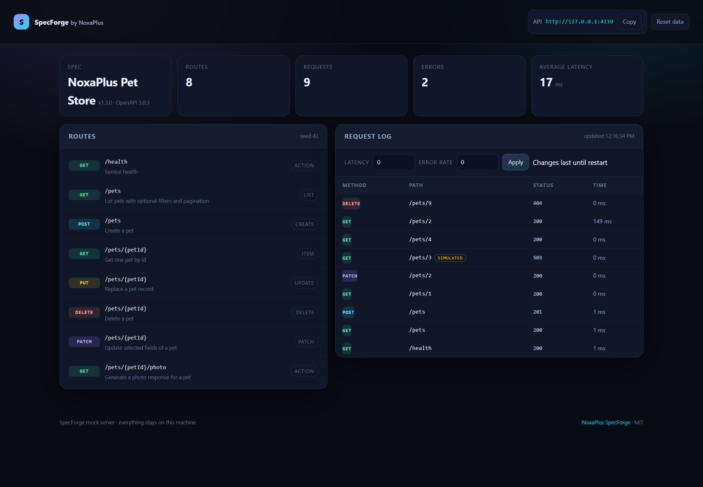

# NoxaPlus SpecForge

**Your OpenAPI file already describes a working API. SpecForge makes it actually run.**

Point SpecForge at an OpenAPI 3.0 or 3.1 document and it serves a real mock API: every route, realistic seeded data, working create/update/delete state, pagination, latency, and failures you can trigger on demand. No account, no cloud, no config file — one command, then a dashboard that shows what just happened.

[](https://github.com/noxaplus-star/noxaplus-specforge/actions/workflows/ci.yml)
[](LICENSE)
[](https://nodejs.org/)

[GitHub repository](https://github.com/noxaplus-star/noxaplus-specforge) · [NoxaPlus](https://www.noxaplus.ir)



## Why this exists

Teams write the OpenAPI file first, then wait days for the backend. In the meantime the frontend stubs `fetch`, the QA suite uses a hand-made fixture that drifts from the spec, and the "demo" version of the product runs on fake JSON nobody trusts. SpecForge closes that gap: the contract you already wrote becomes an HTTP server you can call from a browser, a test, or a mobile app — with data that looks like production and failures you can reproduce without unplugging the network.

It is also the fastest way to answer uncomfortable questions about your own spec. Does the list endpoint return an array or an envelope? Is the item ID a string or a number? What happens when `POST /orders` omits a required field? Start the server and find out.

## Quick start

Requires Node.js 22 or newer.

```bash
npm ci
npm run build
node dist/cli.js mock examples/petstore.yaml
```

The terminal prints the mock URL, the dashboard URL, and the route table:

```text
SpecForge by NoxaPlus
  spec      NoxaPlus Pet Store 1.3.0 (OpenAPI 3.0.3)
  mock      http://127.0.0.1:4010
  dashboard http://127.0.0.1:4010/__specforge
  routes    8 · seed 42 · latency 0 ms · error rate 0

GET     /pets                    list
POST    /pets                    create
GET     /pets/{petId}            item
...
```

Then call it:

```bash
curl http://127.0.0.1:4010/pets
curl -X POST http://127.0.0.1:4010/pets \
  -H "Content-Type: application/json" \
  -d '{"name":"Luna","species":"cat","age":2}'
curl "http://127.0.0.1:4010/pets/3?__error=503"
```

Install the release package globally if you want the `specforge` command anywhere:

```bash
npm install -g https://github.com/noxaplus-star/noxaplus-specforge/releases/download/v1.0.0/noxaplus-specforge-1.0.0.tgz
specforge mock openapi.yaml
```

## What you get

- **Real routes, not one catch-all.** Path parameters, query strings, request bodies, and status codes come from the spec. GET/POST/PUT/PATCH/DELETE map to list, create, update, patch, and delete behavior, including a real in-memory collection.
- **Deterministic seed data.** The same spec and seed produce the same records on every run, so tests and screenshots stop moving. Change `--seed` when you want different data.
- **A working data store.** Create a record and it appears in the list. Update it and the `GET` changes. Delete it and the next `GET` returns 404. `PUT` replaces, `PATCH` merges.
- **Validation at the door.** Required fields are enforced with a 422 that names the missing fields, `readOnly` properties are stripped from incoming bodies, and body parsing errors return a clean 400 — exactly the responses a client needs to handle.
- **Failure injection without code changes.** Force a status per request with `?__error=500`, with an `X-SpecForge-Error` header, or globally with `--error-rate 0.1`. Add slow responses with `?__delay=300` or `--latency 120`.
- **Pagination and sorting.** `__limit`, `__offset`, `__sort`, and `__order` work on every collection route, even ones the spec did not describe.
- **A dashboard that proves it.** `/__specforge` shows the spec, the route table, live request counts, error totals, average latency, and the last 100 requests with full details. No build step, no bundler, no external assets.

## How it works

SpecForge does four things in sequence:

1. **Loads and validates** the OpenAPI document. YAML and JSON are supported. Local `$ref`s are resolved, including pointers into `components`, and each operation is checked for a response schema.
2. **Builds a route table** from paths and methods, classifying each operation as `list`, `item`, `create`, `update`, `patch`, `delete`, or `action`. A GET becomes a list when its response schema is — or contains — an array; nested reads such as `/pets/{petId}/photo` are treated as actions, not collections.
3. **Generates seed data** from the response schemas. Enums, formats (`date`, `date-time`, `email`, `uuid`, `uri`), `example`, `default`, `const`, `allOf`, `oneOf`/`anyOf`, nested objects, and arrays are all honored. Values come from a seeded PRNG keyed by the spec path, so they are stable across restarts.
4. **Serves HTTP** with a small Node `http` server. No framework, no database, no native modules — the only runtime dependency is `yaml`.

## Runtime controls

These work on the running server without restarting it.

| Control | Example | Effect |
| --- | --- | --- |
| `__error` | `/pets/1?__error=503` | Return that status with a SpecForge error body. |
| `X-SpecForge-Error` header | `curl -H "X-SpecForge-Error: 500" ...` | Same, for clients that cannot change the URL. |
| `__delay` | `/pets?__delay=300` | Wait that many milliseconds before responding. |
| `__limit` / `__offset` | `/pets?__limit=2&__offset=3` | Slice a collection response. |
| `__sort` / `__order` | `/pets?__sort=name&__order=desc` | Sort a collection by a field. |
| `--error-rate` | `--error-rate 0.15` | Fail roughly 15% of requests with a 500. |
| `--latency` | `--latency 120` | Add 120 ms to every response. |

The dashboard can change latency and error rate while the server runs. Those two settings reset on restart; everything else is derived from the spec.

## Dashboard and admin API

Open `http://127.0.0.1:4010/__specforge` in a browser. It refreshes every two seconds and shows the current spec title, route count, request and error totals, average latency, and a live request log. Click a request to see the method, path, status, duration, and injected controls.

The same data is available as JSON from the admin API:

```bash
curl http://127.0.0.1:4010/__specforge/api/state        # routes, settings, totals, recent requests
curl -X POST http://127.0.0.1:4010/__specforge/api/reset # empty the store and reload seed data
curl -X POST http://127.0.0.1:4010/__specforge/api/simulate \
  -H "Content-Type: application/json" -d '{"latency":200,"errorRate":0.2}'
```

The admin API is local-only by design. It is useful for test setup and teardown, and it is deliberately not a production management surface.

## CLI reference

```text
specforge mock <openapi.yaml|json> [options]
specforge routes <openapi.yaml|json>
specforge --help
specforge --version
```

| Option | Description |
| --- | --- |
| `--port <number>` | Port to listen on. Default: `4010`. |
| `--host <address>` | Bind address. Default: `127.0.0.1`. |
| `--base <path>` | Prefix every mock route, e.g. `/api`. |
| `--seed <number>` | Seed for deterministic data. Default: `42`. |
| `--latency <ms>` | Add latency to every response. Default: `0`. |
| `--error-rate <0..1>` | Random failure share. Default: `0`. |
| `--quiet` | Suppress one line per request. |

`specforge routes` prints the route table and exits — handy in CI or when reviewing a spec you did not write.

Exit codes: `0` normal stop or route listing, `1` the spec could not be loaded or served, `2` invalid usage.

## Supported OpenAPI surface

SpecForge covers the parts that affect runtime behavior, not the whole specification:

- OpenAPI **3.0.x and 3.1.x**, YAML or JSON;
- paths, operations, path and query parameters;
- request bodies (`application/json`);
- response schemas, including envelopes such as `{ "items": [...] }`;
- local `$ref` resolution, `allOf`, `oneOf`/`anyOf`, `nullable`, `enum`, `const`, `default`, `example`, `format`, `required`, `readOnly`;
- CORS for browser clients.

It does not implement authentication, rate limits, multipart uploads, streaming, webhooks, or `callbacks`. Security schemes in the spec are ignored: the mock accepts any request. That is intentional — a mock exists to remove blockers, and auth is usually the first thing a frontend needs to skip.

Some behaviors are pragmatic rather than literal:

- list responses are wrapped as `{ "items": [...] }` when the spec defines an object envelope, or returned as an array when the spec says array;
- create returns `201` with the stored record;
- delete returns `204` with no body when the record exists;
- validation returns `422` with a list of missing required fields;
- unknown routes return a JSON 404 that names the method and path.

## Examples

```bash
# Prefix everything with /api for a frontend proxy setup
specforge mock openapi.yaml --base /api

# A fresh dataset every day, plus realistic slow responses
specforge mock openapi.yaml --seed $(date +%F | cksum | cut -d' ' -f1) --latency 80

# A flaky environment to test retries
specforge mock openapi.yaml --error-rate 0.2

# Inspect an unfamiliar spec before writing a client
specforge routes vendor-api.yaml
```

## Development

```bash
npm ci
npm run typecheck
npm test        # unit and integration tests, no network required
npm run build
npm run mock    # serve the bundled Pet Store example
```

The code is organized as small modules with one job each:

- `src/load.ts` reads, parses, validates, and resolves the document;
- `src/generate.ts` turns schemas into deterministic sample values;
- `src/routes.ts` classifies operations and matches incoming paths;
- `src/store.ts` keeps the in-memory collections;
- `src/server.ts` handles HTTP, validation, controls, and logging;
- `src/dashboard.ts` renders the self-contained dashboard;
- `src/cli.ts` parses arguments and manages the process lifecycle.

Tests use real HTTP requests against an ephemeral server, so route matching, validation, injection, and the admin API are exercised the same way a client would exercise them.

## Limits and honest expectations

- **It is not a production server.** No TLS, no auth, no clustering, no persistence. Restarting clears everything.
- **Seed data is plausible, not meaningful.** Names, emails, and dates are generated to satisfy the schema; they are not business-correct.
- **Only JSON is mocked.** `application/json` request bodies and response payloads are supported. XML, form data, and binary responses fall back to simple generated values.
- **Schemas with no shape produce empty objects.** If a response has no schema, SpecForge returns `{}` rather than inventing fields.
- **The dashboard exposes local state.** It binds to `127.0.0.1` by default for a reason; do not expose it on a public interface without understanding that anyone who can reach it can read and reset your mock data.

## Privacy

Everything runs on your machine. SpecForge does not create accounts, send telemetry, or contact any remote service. The OpenAPI file you pass in, the generated data, and the request log stay in memory and disappear when the process stops.

## Release notes

See [CHANGELOG.md](CHANGELOG.md). Security reports are handled according to [SECURITY.md](SECURITY.md).

## License

MIT © 2026 NoxaPlus. See [LICENSE](LICENSE).
